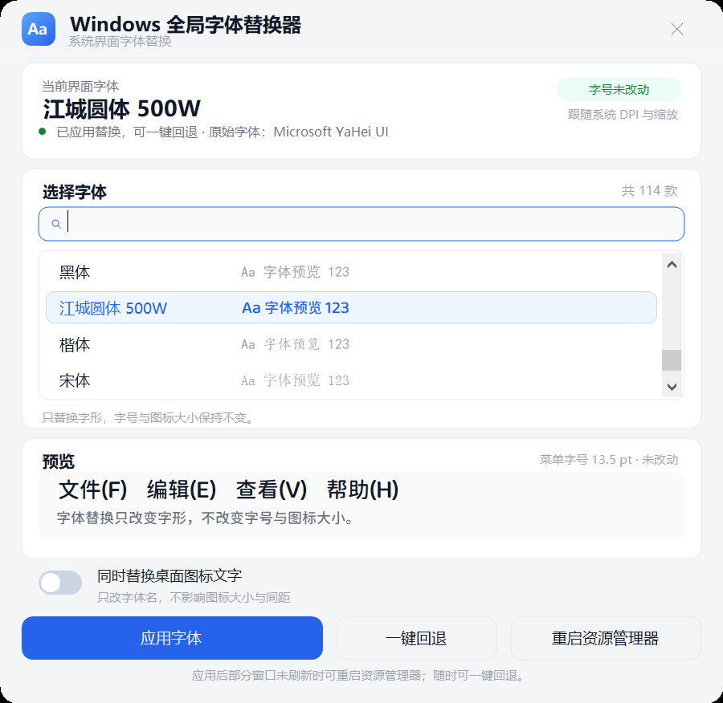
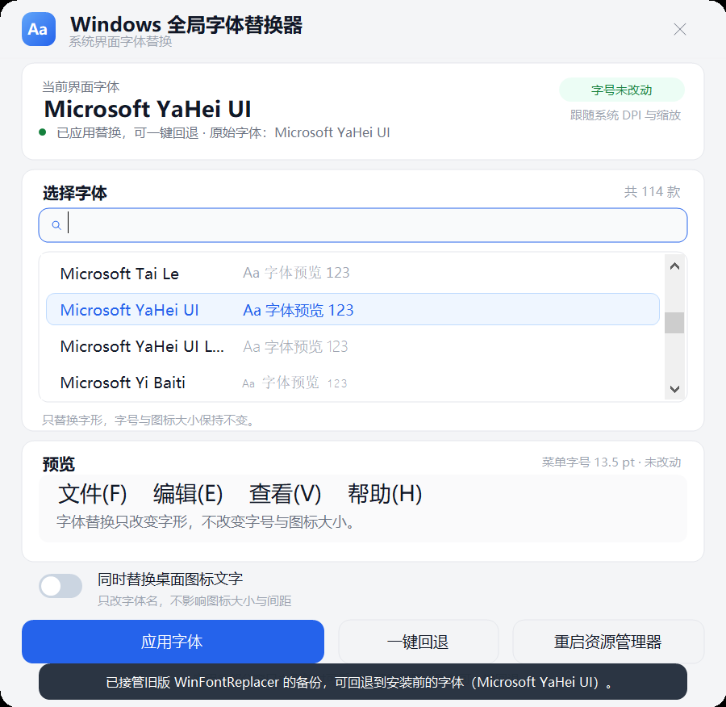

# Windows 全局字体替换器 2.0

> **全新升级版**：只换字形，不动字号，不动图标大小。

这是 1.x 的继任版本，界面与内核全部重写。程序名、图标和便携数据目录沿用原来的，老用户直接覆盖安装即可无缝升级。

## 为什么值得升级

1.0.x 在替换界面字体时，会按当前 DPI 重新计算一遍字号（96 DPI 写 `-12`，144 DPI 写 `-18`），把你在「设置 → 辅助功能 → 文本大小」里调过的值覆盖掉。它还同时写系统级（HKLM）的字体替换与字体链接，必须管理员权限。

2.0 只做一件事：**改掉界面字体族的名字，其余字段一个字节都不碰。**

- 字号（`lfHeight`）原样保留 → 系统自带的字体大小调整、DPI 缩放、文本缩放继续生效
- 只写当前用户（HKCU）→ 不需要管理员权限
- 完全不碰图标大小、图标间距、DPI 设置

## 截图

| 已应用替换 | 从 1.x 升级（自动接管） |
| --- | --- |
|  |  |

## 与 1.0.x 的区别

| | 1.0.x | 2.0 |
| --- | --- | --- |
| 修改位置 | HKLM 字体替换 + 字体链接 + HKCU 窗口字体 | 只改 HKCU 六项窗口字体 |
| 字号 | 按 DPI 重新计算（覆盖用户设置） | 原样保留 |
| 管理员权限 | 需要 | 不需要 |
| 图标大小 | 不处理 | 不处理 |
| 回退 | 恢复 11 项注册表值 | 恢复六项窗口字体 |
| 界面 | WinForms 侧栏 | 重写为单窗口卡片式界面 |

## 老用户怎么升级

1. 退出 1.x；
2. 用 2.0 的 `WinFontReplacer.exe` 覆盖旧目录里的同名文件；
3. 启动新版。如果检测到旧版的 `baseline.xml`，会提示「已接管旧版 WinFontReplacer 的备份」，此时点「一键回退」就能回到 1.x 安装前的字体与字号。

旧版备份会在这几个位置自动查找：

- `%ProgramData%\WinFontReplacer\`
- `<exe 所在目录>\WinFontReplacerData\`
- `%LOCALAPPDATA%\WinFontReplacer\`
- `%TEMP%\WinFontReplacer\`

如果旧版放在别的地方，也可以用命令行指定：

```powershell
.\WinFontReplacer.exe --import-legacy "D:\旧软件目录\WinFontReplacerData\baseline.xml"
```

数据目录同样沿用旧规则：优先便携模式 `<exe 所在目录>\WinFontReplacerData`，其次 `%LOCALAPPDATA%\WinFontReplacer`。

## 原理：只改一个字段

系统把标题栏、菜单、状态栏、对话框、消息框和桌面图标文字的字体，分别存在注册表 `HKCU\Control Panel\Desktop\WindowMetrics` 的六个值里。每个值都是一个 92 字节的 `LOGFONTW` 结构：

| 偏移 | 字段 | 含义 | 2.0 是否修改 |
| --- | --- | --- | --- |
| 0 | `lfHeight` | 字号（负值 = 字符高度像素） | **不改** |
| 4 | `lfWidth` | 字符宽度 | 不改 |
| 8 / 12 | `lfEscapement` / `lfOrientation` | 旋转角度 | 不改 |
| 16 | `lfWeight` | 字重 | 不改 |
| 20–22 | 斜体 / 下划线 / 删除线 | 样式 | 不改 |
| 23–27 | 字符集 / 精度 / 质量 / 间距族 | 渲染参数 | 不改 |
| **28** | **`lfFaceName`** | **字体族名（64 字节 UTF-16LE）** | **只改这里** |

六项分别是：

| 注册表值 | 影响范围 |
| --- | --- |
| `CaptionFont` | 窗口标题栏 |
| `SmCaptionFont` | 小标题栏、部分工具窗口 |
| `MenuFont` | 菜单栏、右键菜单 |
| `StatusFont` | 状态栏 |
| `MessageFont` | 对话框、消息框 |
| `IconFont` | 桌面图标文字（可选） |

写入前会逐字节比对「除 `lfFaceName` 外完全一致」，写入后广播 `WM_SETTINGCHANGE`（`WindowMetrics` 与 `Fonts`）通知各窗口刷新。

## 使用方法

1. 打开程序，在列表里选择字体（可搜索，右侧用该字体渲染预览）；
2. 需要连桌面图标文字一起换时，打开「同时替换桌面图标文字」；
3. 点「应用字体」；
4. 部分窗口（例如已经打开的资源管理器）没刷新时，点「重启资源管理器」。

程序自身的界面固定使用 Microsoft YaHei UI，不随系统字体变化。

## 一键回退

第一次应用前会把六项窗口字体的**完整原始值**（含数据类型）备份到：

- 注册表：`HKCU\Software\WinFontReplacer\Backup`
- 文件：`<数据目录>\backup.txt`

点「一键回退」即可恢复；恢复后备份会被删除。回退不影响字号——备份里存的就是原始字节。

## 兼容性

- Windows 10 / 11（64 位与 32 位均可运行）
- 只影响当前登录用户，不改系统级设置，不改其他用户的配置
- 不改变图标大小、图标间距、DPI 缩放与文本缩放设置
- 部分现代界面（设置、开始菜单、UWP 应用、任务栏弹出面板）由 DirectWrite 渲染，不读取这六项设置，因此不受影响
- 换上的字体需要已安装，否则系统会回退到默认字体

## 命令行

```powershell
.\WinFontReplacer.exe --status
.\WinFontReplacer.exe --apply "微软雅黑"
.\WinFontReplacer.exe --apply "微软雅黑" --icon
.\WinFontReplacer.exe --restore
.\WinFontReplacer.exe --import-legacy [baseline.xml 路径]
.\WinFontReplacer.exe --self-test
```

命令行结果写到 `<数据目录>\cli-result.txt`。因为程序是窗口子系统，脚本里请用 `Start-Process -Wait` 等待它结束。

## 数据与日志

| 内容 | 位置 |
| --- | --- |
| 便携数据目录 | `<exe 所在目录>\WinFontReplacerData\` |
| 用户数据目录 | `%LOCALAPPDATA%\WinFontReplacer\` |
| 回退备份 | `HKCU\Software\WinFontReplacer\Backup` 与 `backup.txt` |
| 设置 | `HKCU\Software\WinFontReplacer\Settings` |
| 操作日志 | `<数据目录>\logs\winfontreplacer-YYYYMMDD.log` |

## 从源码构建

需要 .NET Framework 4.x 自带的 C# 编译器（系统自带，无需安装 SDK）：

```powershell
powershell -ExecutionPolicy Bypass -File .\build.ps1
```

产物为 `dist\WinFontReplacer.exe`（单文件，无依赖）。图标沿用 1.x 的 `src\app.ico`；只有图标缺失时才调用 `tools\make-icon.ps1` 重新生成。

## 目录结构

```
build.ps1              构建脚本
src\                   源码（C# 5，兼容 .NET Framework 4.x 自带编译器）
tools\make-icon.ps1    生成图标（仅在缺少 app.ico 时使用）
tools\capture-ui.ps1   启动程序并截图
assets\                截图与图标
dist\                  构建产物
```

## 已知限制

- 设置、开始菜单、UWP 应用等 DirectWrite 界面不读取这六项，替换后不会变化；
- 只影响当前用户，切换用户或登录界面不受影响；
- 卸载替换所用字体后，「一键回退」会回退到系统默认字体。
